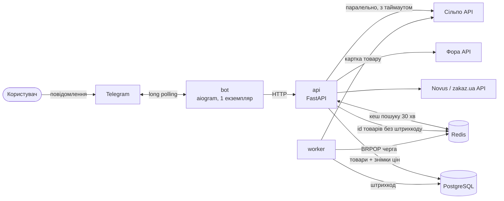

# 🛒 Ціномір (cinomir)

Telegram-бот, який порівнює ціни на товар у супермаркетах **Києва**: Сільпо, Фора, Novus.
Пишеш «тунець у власному соку» — отримуєш товари **в наявності**, від найдешевшого: ціна, вага, акція, мережа.
Кнопка **«⚖️ вигідніше за вагою»** пересортовує той самий список з урахуванням фасовки (ціна за кг рахується, але не показується).

Це навчальний проєкт курсу: на ньому відпрацьовуються всі спринти — від Compose до EKS, GitOps і game days.

## Що вміє (Спринт 00)

- пошук у трьох мережах паралельно, з таймаутом на кожну
- фільтр релевантності: у мережу йде лише головне слово («тунець»), а «корм з тунцем» і «томати у власному соку» відсіюються локально
- наявність: відсутні товари приховані (кількість показується окремим рядком)
- «той самий товар у різних мережах»: зіставлення за штрихкодом (GTIN) і спільним id Сільпо/Фори
- кеш результату на 30 хв: сторінки й пересортування не ходять у мережі повторно
- історія цін у PostgreSQL (кожен пошук = знімок цін)
- приватний бот: лише Telegram id зі списку `ALLOWED_USER_IDS`

**Свідомо відкладено:** АТБ (сайт за Cloudflare-захистом і `robots.txt` забороняє пошук — не обходимо), конкретні адреси магазинів (беремо гостьовий режим «Київ»), збір акцій («Цінотижики» тощо) — окрема фіча в одному з наступних спринтів.

## Архітектура



| Процес | Що робить | Масштабування |
|---|---|---|
| `api` | пошук, кеш, збереження, зіставлення, REST + `/metrics` | горизонтально (stateless) |
| `worker` | дозбирує штрихкоди Сільпо з черги, повільно і ввічливо | горизонтально, але **обережно**: більше воркерів = більше запитів до мережі |
| `bot` | тонкий клієнт до API: форматування, кнопки, allowlist | **лише 1 екземпляр** (long polling: другий отримає `409 Conflict`) |
| `migrate` | `alembic upgrade head` і вихід | one-shot перед стартом api/worker |

Один Docker-образ, три команди запуску.

## Потік пошуку

1. Бот отримує текст → `GET /api/v1/search?q=…`
2. API рахує `search_id = sha1(нормалізований запит + мережі + магазини)` → є в Redis? Віддати з кешу.
3. Ні — паралельно до мереж (семафор на мережу, таймаут на кожну). Мережа впала → у відповіді `ok: false` і причина, решта працює.
4. Фільтр релевантності → upsert товарів + знімок ціни → id товарів Сільпо без штрихкоду в чергу воркеру.
5. Зіставлення (union-find за `ean:…` та `fozzy:id`) → кеш на 30 хв (лише якщо хоч одна мережа відповіла).
6. Пагінація і сортування — з кешу: `GET /api/v1/search/{search_id}?page=2&sort=unit`.

## Джерела даних

| Мережа | Запит | Наявність | Штрихкод |
|---|---|---|---|
| Сільпо | `GET sf-ecom-api.silpo.ua/v1/uk/branches/{branch}/products?search=…` | `stock` (залишок) | лише в картці товару → воркер |
| Фора | `POST api.catalog.ecom.fora.ua/api/2.0/exec/EcomCatalogGlobal` | `quantity` (0 = немає) | ні, але id = `externalProductId` Сільпо |
| Novus | `GET stores-api.zakaz.ua/stores/{store}/products/search/?q=…` | `in_stock` (прапорець) | `ean` у пошуку (GTIN-14 з нулем) |

Це **внутрішні API сайтів**, а не публічні з договором. Правила проєкту:

- особисте використання, низька частота, кеш 30 хв, чесний `User-Agent`
- блокування (Cloudflare 403/429) = зупинитись і повідомити, **не обходити**
- API може змінитись без попередження → адаптер падає з `ChainError`, це видно в метриках, а не «тихо 0 товарів»

## API

| Метод | Шлях | Призначення |
|---|---|---|
| GET | `/healthz` | liveness: процес живий (залежності не перевіряє) |
| GET | `/readyz` | readiness: PostgreSQL і Redis доступні (мережі не впливають) |
| GET | `/metrics` | Prometheus |
| GET | `/api/v1/search?q=&sort=price\|unit&page=&page_size=&include_out_of_stock=` | пошук |
| GET | `/api/v1/search/{search_id}?…` | сторінка / сортування з кешу; `404` — кеш минув |
| GET | `/api/v1/products/{id}/history?limit=` | історія цін товару |

## Метрики

| Метрика | Тип | Навіщо |
|---|---|---|
| `cinomir_http_requests_total{method,path,status}` | counter | RED-метрики API (path = шаблон маршруту) |
| `cinomir_http_request_duration_seconds` | histogram | латентність API |
| `cinomir_chain_requests_total{chain,outcome}` | counter | `ok / timeout / blocked / error` по мережах |
| `cinomir_chain_request_duration_seconds{chain}` | histogram | яка мережа гальмує |
| `cinomir_chain_last_items{chain}` | gauge | скільки товарів повернула мережа востаннє (0 надовго = API змінився) |
| `cinomir_searches_total{cache}` | counter | hit / miss кешу |
| `cinomir_enrich_total{result}` | counter | воркер: found / none / skipped / error |
| `cinomir_bot_updates_total{kind}` | counter | бот: search / page / help / denied |

## Відомі обмеження (матеріал для наступних спринтів)

| Обмеження | Де вирішуємо |
|---|---|
| Бот на long polling — не масштабується, при деплої двох копій `409 Conflict` | 02 (`replicas: 1`, `strategy: Recreate`), 03 (webhook через Gateway API + TLS) |
| Мережі можуть блокувати IP датацентрів | 01 — перевірити з AWS заздалегідь; 06 — план egress |
| Черга воркера `BRPOP`: задача губиться, якщо воркер упав посеред обробки | 09 (reliable queue, `BLMOVE`) |
| `price_snapshots` росте без обмежень | 09 (retention / агрегація) |
| Немає circuit breaker: лежача мережа щоразу з'їдає таймаут | 09 |
| Токен бота — звичайна змінна оточення | 05 / 06 (External Secrets), 08 |
| Немає rate limit на користувача | 08 |

## Як росте репозиторій

```
cinomir/
├── src/cinomir/         # 00: застосунок
├── migrations/          # 00: Alembic
├── tests/               # 00: pytest (SQLite + fakeredis, без мережі)
├── Dockerfile, docker-compose.yml, Makefile
├── .github/workflows/   # 00: CI · 01: terraform · 05: оновлення тегу в config-репо
├── infra/               # 01: Terraform (AWS) · 06: EKS
├── deploy/k8s/          # 02: маніфести + kustomize
├── deploy/chart/        # 03: Helm chart
├── observability/       # 04: дашборди, правила алертів
└── docs/adr/, docs/runbooks/, docs/postmortems/
```
